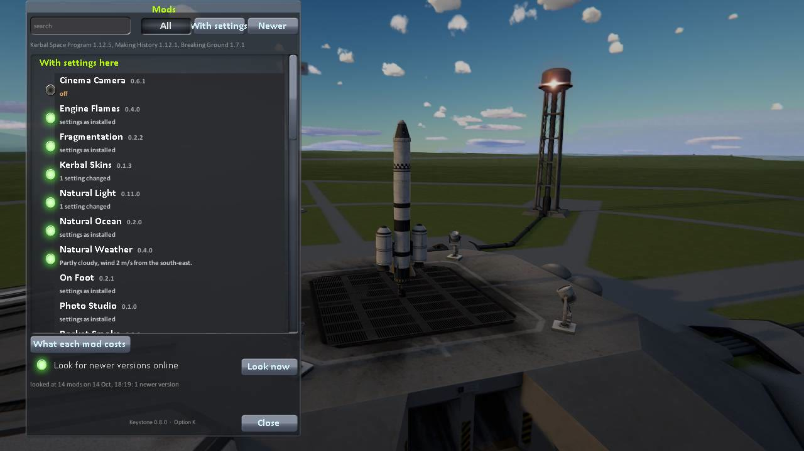

# Keystone

The base that a family of Kerbal Space Program 1 mods stands on, and one window for all of them: every mod installed
is listed there, with switches and settings for the mods made for it.

For Kerbal Space Program 1.12.x. It needs no other mod.

## Install

Copy the `Keystone` folder from the download into your KSP's `GameData`. One copy serves every mod that needs it.

## Use

* **The window** opens from the keystone button on the game's toolbar, or with Alt-K (Option-K on a Mac), in every
  scene. Click a mod for its settings.
* **Settings are kept** in `GameData/Keystone/PluginData/<mod>.cfg`. Deleting a file there puts that mod back as
  installed.
* **What each mod costs:** a page that times every mod's work (it needs the Harmony mod).
* **Newer versions** are looked for on each mod's GitHub page about once a day (a switch turns it off). A mod with a
  newer release gets an **Update** button: it fetches the release, checks it holds only that mod's folders, and puts it
  in (on Windows when you close the game); the old version is kept in `Keystone/Replaced`. Mods installed by CKAN are
  left to CKAN.

## For mod authors

A mod registers with one line and gets a page in the window, settings that are kept and keys a player can change.
Keystone also has a lens and a film that any mod can use.
[Everything a mod can use](https://github.com/IshiakiZ/ksp-keystone/wiki/For-mod-authors).

## Works on

Mac: tried. Windows 11 (Direct3D 11 and OpenGL): 0.7.1 tried; this version built for it, not run there. Linux: never run.

**More:** [the long description](https://github.com/IshiakiZ/ksp-keystone/wiki/The-long-description) (everything in full, and what was
tried on each system) and the rest of the [wiki](https://github.com/IshiakiZ/ksp-keystone/wiki).

## Licence

[CC BY 4.0](LICENSE): use it, change it and pass it on as you like, as long as you credit Ishiaki and link back here.
